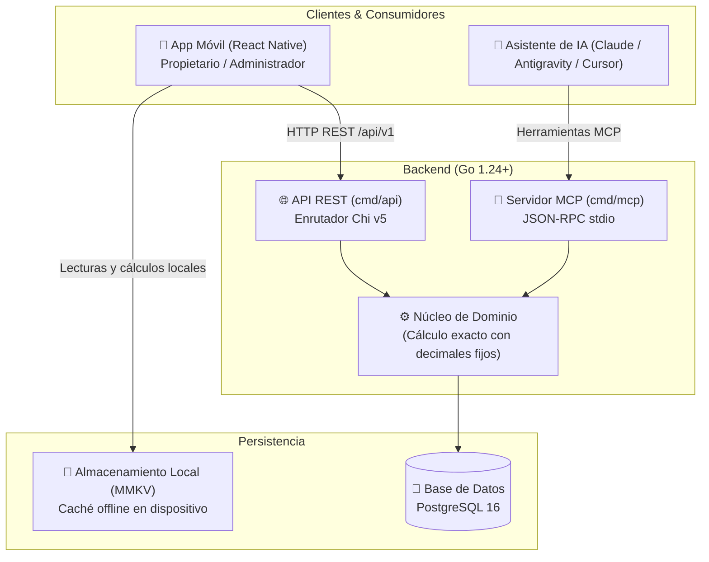

# 🧾 Mi Recibo

> Sistema integral para la gestión, medición y prorrateo automatizado de servicios básicos (luz, agua, gas) en inmuebles de alquiler con múltiples unidades e inquilinos.

---

## 📌 Resumen del Proyecto

**Mi Recibo** resuelve el problema recurrente de cobro de servicios en viviendas multifamiliares o propiedades de alquiler compartido mediante un modelo justo, transparente y auditable:

- **Consumo Propio Estricto**: Cada inquilino paga exclusivamente el consumo registrado en su medidor interno ($\text{Consumo} = \text{Lectura Actual} - \text{Lectura Anterior} \times \text{Precio Unitario}$). Las diferencias por áreas comunes o pérdidas no se trasladan a los inquilinos.
- **Prorrateo Equitativo de Cargos Extras**: Cargos fijos del proveedor (alumbrado público, mantenimiento de red, cargo fijo, etc.) se dividen en partes iguales entre los inquilinos activos, con asignación estable y determinista de centavos sobrantes.
- **Alertas de Sobreconsumo**: Detección automática de incrementos anormales de consumo frente al mes previo (por defecto >20%), generando alertas para revisión de fugas o anomalías.
- **Desglose Transparente**: Liquidaciones y subrecibos detallados ítem por ítem para cada inquilino.
- **Enfoque Multiplataforma & Offline-First**: Aplicación móvil en React Native con persistencia local ultra rápida (MMKV) y backend de alta concurrencia en Go con PostgreSQL 16 y servidor MCP (Model Context Protocol).

---

## 🏗️ Arquitectura del Sistema



---

## 📁 Estructura del Repositorio

El proyecto está organizado como un monorepo modular:

```
mi-recibo/
├── back/                      # Backend en Go + PostgreSQL 16
│   ├── cmd/
│   │   ├── api/               # Entrypoint del servidor HTTP REST
│   │   └── mcp/               # Entrypoint del servidor MCP para IA
│   ├── docs/                  # OpenAPI 3.0, documento de arquitectura y Postman
│   ├── internal/              # Clean Architecture (domain, service, repository, handler)
│   ├── migrations/            # Migraciones SQL versionadas
│   ├── docker-compose.yml     # Contenedor de PostgreSQL 16
│   └── README.md              # Documentación detallada del backend y endpoints
├── front-mobile/              # Aplicación móvil en React Native (iOS / Android)
│   ├── android/               # Proyecto nativo Android
│   ├── ios/                   # Proyecto nativo iOS (CocoaPods)
│   ├── docs/                  # Documentación de persistencia local y planillas
│   ├── src/                   # Pantallas, módulos de dominio y componentes
│   └── README.md              # Documentación de instalación y desarrollo móvil
├── LICENSE                    # Licencia MIT
└── README.md                  # Este documento general
```

---

## 📋 Requisitos Previos

Asegúrate de contar con las siguientes herramientas instaladas en tu equipo de desarrollo:

| Herramienta | Versión Mínima | Uso |
| :--- | :--- | :--- |
| **Go** | 1.22+ (recomendado 1.24+) | Backend, API REST y servidor MCP |
| **PostgreSQL** | 16+ (Docker o local con Homebrew) | Base de datos relacional principal |
| **Node.js** | 22.11+ | Entorno de ejecución para React Native |
| **npm** | 10+ / 11+ | Gestor de paquetes frontend |
| **CocoaPods** | 1.14+ (macOS) | Dependencias nativas de iOS |
| **Xcode / Android Studio** | Versiones recientes | Compilación y simuladores/emuladores |

---

## 🚀 Cómo Correr la App (Guía Rápida Paso a Paso)

Sigue estos pasos para levantar el entorno completo (base de datos, backend y frontend móvil):

### Paso 1: Clonar el Repositorio

```bash
git clone https://github.com/RoggerParedesTavara/mi-recibo.git
cd mi-recibo
```

---

### Paso 2: Levantar la Base de Datos (PostgreSQL 16)

Tienes dos opciones para ejecutar la base de datos:

#### Opción A: Con Docker Compose (Recomendado)
```bash
cd back
docker compose up -d
cd ..
```
*Esto levantará una instancia de PostgreSQL 16 expuesta en el puerto `5432` con usuario `postgres` y contraseña `postgres`.*

#### Opción B: Con PostgreSQL Local (macOS con Homebrew)
```bash
brew services start postgresql@16
createdb mi_recibo
```

---

### Paso 3: Configurar y Levantar el Backend (API REST)

1. **Configurar variables de entorno**:
   ```bash
   cd back
   cp .env.example .env
   ```
   *(Las variables por defecto apuntan a `localhost:5432` con usuario y contraseña `postgres`).*

2. **Ejecutar el servidor**:
   ```bash
   go run cmd/api/main.go
   ```
   > ℹ️ **Nota**: El backend aplica automáticamente las migraciones SQL al iniciar.

3. **Verificar que la API responda**:
   Abre otra terminal y ejecuta:
   ```bash
   curl http://localhost:8080/health
   # Respuesta esperada: {"service":"mi-recibo-api","status":"ok"}
   ```

---

### Paso 4: Configurar y Levantar el Frontend Móvil (`front-mobile`)

1. **Instalar dependencias**:
   ```bash
   cd front-mobile
   npm ci
   ```

2. **Configurar variables de entorno**:
   ```bash
   cp .env.example .env
   ```
   Ajusta `API_BASE_URL` en `.env` según la plataforma que vayas a usar:
   - **Simulador iOS**: `API_BASE_URL=http://localhost:8080/api/v1`
   - **Emulador Android**: `API_BASE_URL=http://10.0.2.2:8080/api/v1` *(10.0.2.2 es el alias del host en el emulador de Android)*
   - **Dispositivo físico**: `API_BASE_URL=http://<TU_IP_LOCAL>:8080/api/v1`

3. **Instalar CocoaPods (Solo si compilas para iOS en macOS)**:
   ```bash
   cd ios
   pod install
   cd ..
   ```

4. **Iniciar el empaquetador Metro**:
   ```bash
   npm start
   ```

5. **Lanzar la aplicación**:
   En una nueva terminal dentro de `front-mobile/`:
   - **Para iOS**:
     ```bash
     npm run ios
     ```
   - **Para Android**:
     ```bash
     npm run android
     ```

---

### Paso 5: Iniciar Sesión en la App (Credenciales Demo)

Al abrir la aplicación en tu simulador o dispositivo:

- **Usuario**: `coral`
- **Contraseña**: `coral`

La app viene precargada con datos de demostración de **Casa Palermo**, con dos unidades residenciales, dos inquilinos y las tarifas históricas de **Enel (Luz)** y **Sedapal (Agua)** para que puedas explorar la toma de mediciones y los cálculos de liquidación inmediatamente.

---

## 🤖 Servidor MCP (Model Context Protocol)

El backend incluye un servidor MCP que permite a asistentes de inteligencia artificial (como **Claude Desktop**, **Antigravity** o **Cursor**) interactuar con la base de datos y la lógica de negocio mediante lenguaje natural.

### Compilar el binario MCP:
```bash
cd back
go build -o mcp cmd/mcp/main.go
```

### Configuración en Claude Desktop o Antigravity:
Agrega la siguiente sección a tu archivo de configuración de MCP:
```json
{
  "mcpServers": {
    "mi-recibo": {
      "command": "/ruta/absoluta/a/mi-recibo/back/mcp",
      "env": {
        "DB_HOST": "localhost",
        "DB_PORT": "5432",
        "DB_USER": "postgres",
        "DB_PASSWORD": "postgres",
        "DB_NAME": "mi_recibo",
        "DB_SSLMODE": "disable"
      }
    }
  }
}
```

---

## 🧪 Pruebas y Control de Calidad

### Backend (Go):
```bash
cd back

# Tests unitarios del motor matemático de prorrateo
go test -v ./internal/domain/...

# Tests de integración E2E de la API
go test -v ./cmd/api/...

# Suite completa
go test -v ./...
```

### Frontend Móvil (React Native):
```bash
cd front-mobile

# Tests unitarios con Jest
npm test -- --runInBand

# Verificación estática de tipos con TypeScript
npx tsc --noEmit

# Análisis estático de código con ESLint
npm run lint
```

---

## 📚 Enlaces a Documentación Detallada

Para profundizar en áreas específicas del proyecto, consulta la documentación interna:

- 📖 **[Documentación del Backend (`back/README.md`)](./back/README.md)**: Manual exhaustivo de la API REST, ejemplos completos de `curl` para cada endpoint y flujo de liquidación.
- 📐 **[Documento de Arquitectura (`back/docs/architecture.md`)](./back/docs/architecture.md)**: Justificación técnica, principios Clean Architecture, diagramas de base de datos y formulación matemática.
- 📄 **[Especificación OpenAPI 3.0 (`back/docs/openapi.yaml`)](./back/docs/openapi.yaml)**: Contrato formal de la API para Swagger UI, Insomnia o Postman.
- 📬 **[Colección de Postman (`back/docs/mi-recibo.postman_collection.json`)](./back/docs/mi-recibo.postman_collection.json)**: Peticiones preconfiguradas con variables de entorno para pruebas manuales.
- 📱 **[Documentación del Frontend (`front-mobile/README.md`)](./front-mobile/README.md)**: Guía detallada de desarrollo móvil, componentes y resolución de problemas.
- 💾 **[Persistencia Local y Planillas (`front-mobile/docs/local-data.md`)](./front-mobile/docs/local-data.md)**: Esquema de almacenamiento local con MMKV, cálculo de tarifas de luz/agua e IGV.

---

## 🛠️ Solución de Problemas Frecuentes

<details>
<summary><b>1. Error de conexión con PostgreSQL al iniciar el backend</b></summary>

- Verifica que el servicio esté corriendo con `docker compose ps` o `brew services list`.
- Comprueba que las credenciales en `back/.env` coincidan con tu base de datos (`DB_USER`, `DB_PASSWORD`, `DB_NAME`, `DB_PORT`).
- Si el puerto `5432` está ocupado por otra instancia, cámbialo en `docker-compose.yml` y en tu `.env`.
</details>

<details>
<summary><b>2. La app móvil en Android muestra "Network Error" al llamar a la API</b></summary>

- Recuerda que en el emulador de Android `localhost` hace referencia al propio teléfono virtual.
- Cambia la variable en `front-mobile/.env` a:
  ```env
  API_BASE_URL=http://10.0.2.2:8080/api/v1
  ```
- Reinicia el empaquetador Metro con `npm start -- --reset-cache`.
</details>

<details>
<summary><b>3. Problemas con CocoaPods en iOS al compilar</b></summary>

- Ejecuta:
  ```bash
  cd front-mobile/ios
  rm -rf Pods Podfile.lock build
  pod repo update
  pod install
  cd ..
  ```
</details>

<details>
<summary><b>4. Metro Bundler congelado o mostrando errores de módulos no encontrados</b></summary>

- Detén Metro (`Ctrl + C`) y ejecútalo limpiando la caché:
  ```bash
  npm start -- --reset-cache
  ```
</details>

---

## 📄 Licencia

Este proyecto se distribuye bajo la licencia **MIT**. Consulta el archivo [LICENSE](./LICENSE) para más información.
